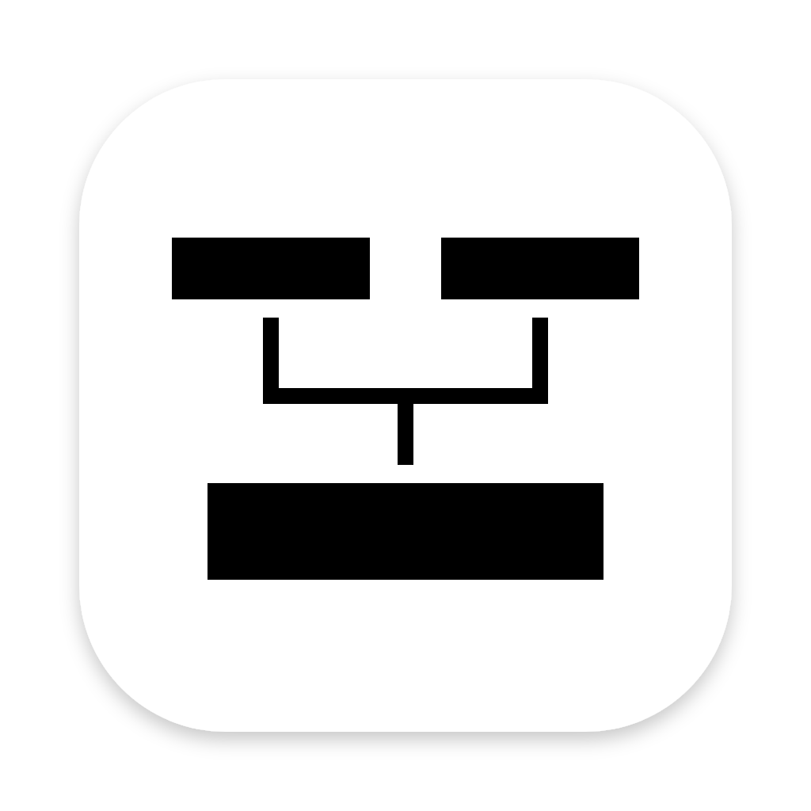

<p align="center"></p>

# LCNDA — Le Carnet numérique des ancêtres

Une application de généalogie **locale, gratuite et open source** pour travailler son histoire familiale :
personnes, familles, événements, actes, photos, archives, enquêtes et cartes.

- **Vos données restent chez vous.** Tout est enregistré sur votre ordinateur, dans une base SQLite. Aucun compte,
  aucun serveur, aucun envoi.
- **Une vraie application de bureau** pour macOS, Windows et Linux, sans rien à installer à côté.
- **Des sauvegardes automatiques** avant chaque mise à jour de la structure de la base.

> Pensé et designé par **Victor Baissait**. Codé par **Codex (ChatGPT)** et **Claude**, sous la supervision de
> Victor Baissait.

## Télécharger

Les installateurs sont publiés dans la page **Releases** de ce dépôt :

| Système | Fichier | Minimum |
|---|---|---|
| macOS (Apple Silicon ou Intel) | `LCNDA-…-mac-arm64.dmg` / `…-mac-x64.dmg` | macOS 13 Ventura |
| Windows (PC x64, et Windows 11 ARM) | `LCNDA-…-windows-x64.exe` | Windows 10 |
| Linux (x64 ou ARM) | `LCNDA-…-linux-….AppImage` ou `.deb` | distribution récente |

Les versions actuelles ne sont pas encore signées : au premier lancement, macOS demande de l'autoriser dans
*Réglages Système → Confidentialité et sécurité → Ouvrir quand même*, et Windows affiche « Windows a protégé votre
ordinateur » (*Informations complémentaires → Exécuter quand même*).

## Licence

Le code de LCNDA est distribué sous licence **GNU Affero General Public License v3.0 ou ultérieure**
(AGPL-3.0-or-later). Texte complet : [LICENSE](LICENSE).

**En langage simple, vous pouvez :**
- utiliser LCNDA librement, pour vous, votre famille, une association ;
- étudier et modifier son code ;
- le redistribuer, modifié ou non.

**En échange :**
- toute version modifiée que vous distribuez doit rester sous la même licence, avec son code source ;
- si vous faites utiliser une version modifiée **par internet** (un site, un service en ligne), vous devez aussi
  donner accès à son code source à ses utilisateurs — c'est ce qu'ajoute l'AGPL à la GPL ;
- conservez les mentions de licence et les crédits des auteurs.

**Pourquoi l'AGPL ?** LCNDA est, au fond, une application web (PHP + une page). Sans la clause réseau de l'AGPL,
n'importe qui pourrait en faire un service en ligne payant et fermé sans partager ses améliorations. L'AGPL garantit
que LCNDA reste un bien commun.

LCNDA est fourni **sans aucune garantie** (articles 15 et 16 de la licence) : faites des sauvegardes.

## Composants tiers

Ces composants gardent leur propre licence :

| Composant | Rôle | Licence |
|---|---|---|
| [Electron](https://www.electronjs.org) | fenêtre de l'application (inclut Chromium et Node.js) | MIT (+ licences Chromium, fournies avec l'application) |
| [PHP](https://www.php.net) | moteur de l'application | PHP License 3.01 |
| [static-php-cli](https://github.com/crazywhalecc/static-php-cli) | PHP embarqué pour macOS et Linux | MIT (bibliothèques incluses sous leurs licences) |
| [SQLite](https://sqlite.org) | base de données | domaine public |
| [three.js](https://threejs.org) r162 | graphiques en 3D | MIT |
| [GeoNames](https://www.geonames.org) (FR.zip, cities1000) | communes, lieux-dits et villes du monde (`data/reference/`) | [CC BY 4.0](https://creativecommons.org/licenses/by/4.0/) |
| Contours des communes (IGN Admin Express, via [france-geojson](https://github.com/gregoiredavid/france-geojson)) | battues, cartes (`data/reference/geo-fr`) | [Licence Ouverte 2.0](https://www.etalab.gouv.fr/licence-ouverte-open-licence/) |
| Communes de Belgique 2025 (IGN-NGI, via [ODWB](https://www.odwb.be/)) | battues (`data/reference/geo-be`) | Licence ouverte IGN-NGI (mention de la source) |
| Communes de Suisse et du Liechtenstein (swissBOUNDARIES3D, [swisstopo](https://www.swisstopo.admin.ch/)) | battues (`geo-ch`, `geo-li`) | Opendata BY (mention « © swisstopo ») |
| Communes du Luxembourg (cadastre, [data.public.lu](https://data.public.lu/)) | battues (`geo-lu`) | CC0 |
| Communes d'Allemagne (VG250, © [GeoBasis-DE / BKG](https://gdz.bkg.bund.de/)) | battues (`geo-de`) | [dl-de/by-2-0](https://www.govdata.de/dl-de/by-2-0) |
| Communes d'Italie (confini amministrativi, © [ISTAT](https://www.istat.it/)) | battues (`geo-it`) | CC BY 4.0 |
| Communes d'Autriche (© [Statistik Austria](https://data.statistik.gv.at/)) | battues (`geo-at`) | CC BY 4.0 |
| Communes d'Espagne (recintos municipales, © [IGN / CNIG](https://www.ign.es/)) | battues (`geo-es`) | CC BY 4.0 |
| Communes d'outre-mer (IGN Admin Express, via france-geojson) | battues (`geo-om`) | Licence Ouverte 2.0 |
| Communes de Tchéquie (RÚIAN, © [ČÚZK](https://cuzk.gov.cz/)) | battues (`geo-cz`) | CC BY 4.0 |
| Communes de Slovaquie (ZBGIS, © [ÚGKK SR](https://www.geoportal.sk/)) | battues (`geo-sk`) | CC BY 4.0 |
| Communes de Pologne (PRG, © [GUGiK](https://www.geoportal.gov.pl/)) | battues (`geo-pl`) | données libres, tout usage |
| Communes des Pays-Bas (Bestuurlijke Gebieden, © [Kadaster / PDOK](https://www.pdok.nl/)) | battues (`geo-nl`) | CC BY 4.0 |
| Communes de Slovénie (RPE, © [GURS](https://www.e-prostor.gov.si/)) | battues (`geo-si`) | CC BY 4.0 |
| Communes de Hongrie (MKH, © [Lechner Tudásközpont](https://lechnerkozpont.hu/)) | battues (`geo-hu`) | libre accès et usage |
| Municipalités du Québec (SDA, © [Gouvernement du Québec](https://www.donneesquebec.ca/)) | battues (`geo-qc`) | CC BY 4.0 |
| Comtés des États-Unis ([U.S. Census Bureau](https://www.census.gov/), Cartographic Boundary Files) | battues (`geo-us`) | domaine public |
| Paroisses d'Angleterre et du pays de Galles (© [ONS](https://geoportal.statistics.gov.uk/), contient des données OS © Crown copyright) et paroisses civiles d'Écosse (© [National Records of Scotland](https://www.nrscotland.gov.uk/)) | battues (`geo-gb`) | [Open Government Licence v3](https://www.nationalarchives.gov.uk/doc/open-government-licence/version/3/) |
| Paroisses civiles d'Irlande (© [Tailte Éireann](https://tailte.ie/)) | battues (`geo-ie`) | CC BY 4.0 |
| Communes de Finlande (© [Statistics Finland](https://stat.fi/)) | battues (`geo-fi`) | CC BY 4.0 |
| Collectivités locales d'Australie (© [Australian Bureau of Statistics](https://www.abs.gov.au/)) | battues (`geo-au`) | CC BY 4.0 |
| Communes des autres pays : Portugal, Croatie, Bosnie-Herzégovine, micro-États, pays baltes et nordiques, Balkans, Roumanie, Bulgarie, Grèce, Turquie, Caucase, Ukraine, Biélorussie, Maghreb, Liban, Jordanie, reste du Canada, Mexique, Amérique centrale, Nouvelle-Zélande, Nouvelle-Calédonie, Polynésie, Wallis-et-Futuna (© les contributeurs d'[OpenStreetMap](https://www.openstreetmap.org/copyright), récupérées par `scripts/fetch-osm-boundaries.php`) | battues (`geo-<code du pays>`) | [ODbL 1.0](https://opendatacommons.org/licenses/odbl/) : ces fichiers restent sous ODbL |
| Communes d'une partie de l'Afrique et de Taïwan ([geoBoundaries](https://www.geoboundaries.org), d'après gouvernements, OCHA, Banque mondiale, GRID3… ; récupérées par `scripts/fetch-geoboundaries.php`) | battues (`geo-<code du pays>`) | licences ouvertes, indiquées dans la table `reference_info` de chaque fichier (domaine public, CC BY, CC BY IGO, ODbL ; CC BY-SA pour le Togo et Taïwan) |

Les fonds de carte (OpenStreetMap, CARTO, OpenTopoMap, IGN, Esri…) sont chargés depuis internet, uniquement quand
vous affichez une carte, et restent soumis aux conditions de leurs fournisseurs.

## Pour les développeurs

Prérequis : [Node.js](https://nodejs.org) 22.12 ou plus récent.

```bash
npm install            # installe Electron et les outils de fabrication
npm run fetch:php      # télécharge et vérifie (sha256) le PHP embarqué de votre système
npm run test:php       # 21 vérifications : serveur, sécurité, relais multi-PHP
npm run test:migrations  # 8 vérifications : mises à jour de la base, sauvegardes
npm start              # lance l'application
npm run dist:mac-arm64 # fabrique l'installateur (voir aussi dist:mac, dist:win, dist:linux)
```

Organisation : `index.php`, `api.php`, `upload.php`, `router.php` et `lib/` (application PHP) ;
`assets/` (interface) ; `electron/` (fenêtre, pilotage de PHP, fabrication) ; `lib/migrations.php` (structure de la
base, numérotée) ; `tests/`.

**Données personnelles :** le dépôt ne contient et ne doit contenir aucune base, aucun média, aucune sauvegarde
(`.gitignore`). La fabrication des installateurs s'arrête d'elle-même si elle en trouve (garde-fou dans
`electron/build/hooks.js`).
